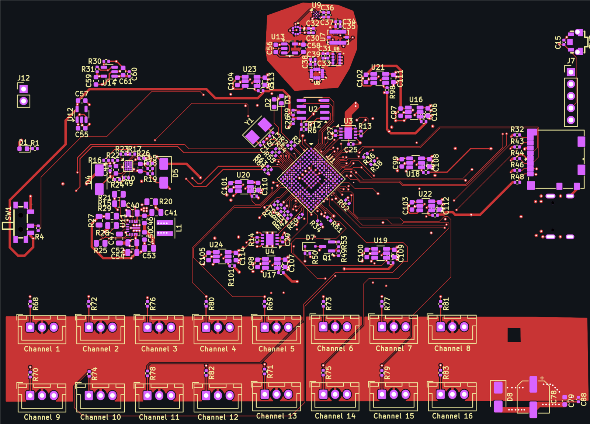

# SvayamV3_IIK — STM32H743 Flight Controller

**6-layer · 125 × 90 mm · STM32H743IIK6 · 16 servo channels · 9 protected peripheral ports**



> ### ⚠️ Design status: layout in progress — **not fabrication-ready**
> Schematic is complete and frozen (ERC **0 errors**). Placement is finalised and **every
> functional net is electrically connected** (`unconnected_items` = 0), but DRC still reports
> **5 shorts** — all of them vias sitting inside unassigned connector `MP` pads — plus vias and
> drills outside the current rule set. **Do not order boards from this revision.**
> See [docs/STATUS.md](docs/STATUS.md).

---

## Contents

| | |
|---|---|
| [What this is](#what-this-is) | [Board specifications](#board-specifications) |
| [Hardware architecture](#hardware-architecture) | [Repository layout](#repository-layout) |
| [Documentation](#documentation) | [Opening the project](#opening-the-project) |
| [Board statistics](#board-statistics) | [Fabrication](#fabrication) |
| [Open items before fabrication](#open-items-before-fabrication) | [License](#license) |

---

## What this is

A servo-based UAV flight controller built around the **STM32H743IIK6** (Cortex-M7,
UFBGA-201, 0.65 mm pitch). The board distributes power to a fixed-wing/multirotor airframe
with **16 PWM servo outputs**, redundant IMU and barometer sensing, dual CAN, USB-C, micro-SD
logging, and nine current-limited peripheral ports for GPS, telemetry radios, and external
sensors.

Design priorities, in order:

1. **Repairability** — silkscreen carries *function* labels (`Channel 1`…`Channel 16`,
   `TELEM1`, `GPS`, `SBUS`, …) instead of values; component values live on the `F.Fab`
   layer so they stay readable in the editor and in fab documentation without cluttering
   the assembled board.
2. **Survivability** — every external port sits behind a TPS2553 current limiter; TVS
   diodes on the battery and servo rails; separate LDO domains for FMU and sensors.
3. **Do-no-harm to the airframe** — the `+VSERVO` rail is *fail-last*: it has no on-board
   source and no series fuse, so a failed BEC cannot brown out the flight controller.

---

## Board specifications

| Parameter | Value | Source |
|---|---|---|
| Board size | 125.15 × 89.96 mm (11,258 mm²) | `kicad-cli pcb export stats` |
| Layers | 6 — `F.Cu` / `In1.Cu` / `In2.Cu` / `In3.Cu` / `In4.Cu` / `B.Cu` | board setup |
| Finished thickness | 1.5584 mm | board setup |
| Copper weight | 1 oz outer (35 µm), 0.5 oz inner (15.2 µm) | board setup |
| Target stackup | JLCPCB `JLC06161H-3313` (3313 / FR4 / 2116 prepregs) | [docs/STACKUP.md](docs/STACKUP.md) |
| Surface finish | ENIG | board setup |
| MCU | STM32H743IIK6 — UFBGA-201, 10 × 10 mm, 0.65 mm pitch | `U1` |
| HSE crystal | 8 MHz, SMD5032-2P | `Y1` (X50328MSB2GI) |
| Minimum track width | 0.10 mm (BGA fan-out only) | DRC report |
| Minimum drill | 0.15 mm (BGA fan-out vias) | DRC report |
| Vias | 475 through-hole (0.30 / 0.20 / 0.15 mm drill) | board stats |
| Pads | 1,005 SMD · 63 THT · 6 NPTH | board stats |
| Component placements | 290 (190 front / 100 back) | board stats |
| Design rules | `SvayamV3_IIK.kicad_dru` — global 0.127 mm, BGA rule area, net classes | project |

---

## Hardware architecture

### Compute and storage

| Ref | Part | Function |
|---|---|---|
| `U1` | STM32H743IIK6 | Cortex-M7 FMU, 480 MHz |
| `U2` | FM25CL64B | 64 kbit FRAM for parameters (SPI) |
| `J10` | Molex 104031-0811 | micro-SD card, card-detect |
| `J7` | 1×05 2.54 mm | SWD / debug service header |
| `Y1` | X50328MSB2GI | 8 MHz HSE crystal (`U1` PH0/PH1) |

### Sensing — redundant by design

| Ref | Part | Function |
|---|---|---|
| `U7` | BMI088 | IMU #1 (accel + gyro) |
| `U8` | BMI270 | IMU #2 |
| `U5` | BMP388 | barometer #1 |
| `U6` | DPS310XTSA1 | barometer #2 |
| `U9` | BMM150 | magnetometer (WLCSP-12) |

The sensor block is laid out as its own quiet zone with a dedicated `+3V3_SENS` domain and
local copper pour, kept away from the switching regulator.

### Power chain

```
POWER1 (J9) ─┐
             ├─► U10 TPS2120  power mux ─► U11 TPS63070  buck-boost 5 V ─► U14 AP22804 ─► +5V_PERIPH
POWER2 (J16)─┘        (ILIM R24 = 33k)          (R27/R28 → 4.99 V)                        │
                                                                                          ├─► U16…U24  9× TPS2553 current limiters
                                                                                          │     GPS · TELEM1 · TELEM2 · SERIAL4 ·
                                                                                          │     SERIAL5 · I2C · CAN · CAN2 · SPI
                                              U12 RT9080 ─► +3V3_FMU  (MCU, IO)            │
                                              U13 RT9080 ─► +3V3_SENS (sensor zone)        │
                                              U15 USBLC6-2SC6 ─► USB-C ESD              +VSERVO
                                                                                          (external BEC, fail-last)
```

* TVS: `D4`/`D5` on `+VBRICK1`/`+VBRICK2`, `D8` SMAJ6.0A on `+VSERVO`.
* `+VSERVO` reservoir: `C78` 220 µF bulk + 16 × 1 µF per channel.
* Per-port trip current is set by each limiter's `RILIM`: `U16` R84 33k, `U17` R85 33k,
  `U18` R86 75k, `U19` R87 75k, `U20` R88 110k, `U21` R89 47k, `U22` R90 56k,
  `U23` R91 110k, `U24` R92 47k.

### Connectors

| Purpose | Ref | Purpose | Ref |
|---|---|---|---|
| POWER1 | `J9` | POWER2 | `J16` |
| RCIN / SBUS | `J6` | GPS | `J2` |
| TELEM1 | `J4` | TELEM2 | `J5` |
| SERIAL4 | `J8` | SERIAL5 | `J14` |
| I2C | `J17` | SPI | `J3` |
| CAN | `J13` | CAN2 | `J18` |
| SAFETY | `J15` | BUZZER | `J11` |
| ADC | `J12` | SD card | `J10` |
| USB-C | `J1` | SWD service | `J7` |

Servo outputs `J19`–`J34` (JST-XH `B3B-XH-A`, 2.50 mm, pin order **S / V+ / GND**) map
`Channel 1`…`Channel 16` in physical order along the board edge.

---

## Repository layout

```
.
├── SvayamV3_IIK.kicad_pro      # KiCad 10 project
├── SvayamV3_IIK.kicad_sch      # root sheet
│   ├── microcontroller.kicad_sch
│   ├── sensor.kicad_sch
│   ├── power.kicad_sch
│   └── connector.kicad_sch
├── SvayamV3_IIK.kicad_pcb      # 6-layer board
├── SvayamV3_IIK.kicad_dru      # custom DRC rules (global + BGA rule area)
├── fp-lib-table                # project footprint table (${KIPRJMOD})
├── sym-lib-table               # project symbol table (${KIPRJMOD})
├── Library/                    # custom + converted libraries (symbols, footprints, 3D)
├── docs/
│   ├── schematic.pdf           # full multi-sheet schematic (exported)
│   ├── STATUS.md               # live status + open DRC items
│   ├── DESIGN.md               # design decisions and their rationale
│   ├── STACKUP.md              # layer stackup and impedance notes
│   ├── board-stats.txt         # kicad-cli board statistics
│   ├── bom.csv                 # BOM (grouped by value + footprint)
│   ├── images/                 # PCB previews for this README
│   └── reports/                # dated ERC / DRC reports
└── fabrication/
    └── README.md               # fab gate, export commands, JLCPCB notes
```

Machine-local working files (`.history/`, `output/`, `*-backups/`, `*.kicad_prl`,
`.deepseek-sources/`) are deliberately **not** tracked — see `.gitignore`.

---

## Documentation

| Document | What it answers |
|---|---|
| [docs/STATUS.md](docs/STATUS.md) | Where the design is right now; open DRC items; next steps |
| [docs/DESIGN.md](docs/DESIGN.md) | Why the power chain, limiter setpoints and sensor redundancy look like this |
| [docs/STACKUP.md](docs/STACKUP.md) | Layer order, dielectrics, trace width / current table, via classes |
| [docs/schematic.pdf](docs/schematic.pdf) | Printable schematic, all four sheets |
| [docs/bom.csv](docs/bom.csv) | BOM — 88 line items (49 still need an MPN) |
| [docs/reports/](docs/reports/) | Raw `kicad-cli` ERC and DRC output, dated |
| [fabrication/README.md](fabrication/README.md) | What must pass before gerbers may be exported |

---

## Opening the project

1. KiCad **10.0** or newer (`generator_version 10.0`, format `20260206`). Older KiCad
   cannot open the project.
2. Open `SvayamV3_IIK.kicad_pro`. Both library tables resolve through `${KIPRJMOD}`, so the
   project is self-contained — no global library setup required.
3. Run **Tools → Update PCB from Schematic (F8)** only if the PCB and schematic have drifted;
   on a clean checkout they are in parity (0 issues).

> **Known limitation:** `sym-lib-table` registers the custom library under the nickname
> `Svayam_Symbol`, while the schematic references it as `Svayam`, and a stale `tps63070`
> entry points at a footprint directory. Symbols are embedded in the sheets, so the project
> opens and plots correctly — but ERC will report 9 `lib_symbol_issues` warnings until the
> table nickname is aligned. See [docs/STATUS.md](docs/STATUS.md#known-library-table-issues).

---

## Board statistics

Numbers below come straight from `kicad-cli pcb export stats` and the ERC/DRC reports in
[docs/reports/](docs/reports/):

| Metric | Value |
|---|---|
| Footprints | 290 (190 front, 100 back — 19 THT, 267 SMD, 4 mechanical) |
| Nets | 262 (203 carry copper, 59 are single-pin NC) |
| Nodes | 1,005 |
| Track segments | 2,897 |
| Vias | 475 through-hole |
| Copper zones | 8 |
| ERC | **0 errors / 17 warnings** (all library-symbol cosmetics) |
| DRC | 760 findings (321 error / 439 warning) — see below for the ones that matter |
| Schematic parity | 0 issues |

---

## Fabrication

**No gerbers are published for this revision — the design is not ready to order.**
The release gate and exact commands live in [fabrication/README.md](fabrication/README.md).

Intended process: **JLCPCB, 6 layers, 1.6 mm, ENIG**, stackup `JLC06161H-3313`.

---

## Open items before fabrication

| # | Item | Count | Notes |
|---|---|---|---|
| 1 | `shorting_items` | 5 | all five are vias sitting inside unassigned `MP` pads of `J17` (both pads) and `J11` — move the vias **before** tying `MP` to GND |
| 2 | ~~`unconnected_items`~~ | ~~7~~ → **0** | closed 2026-10-25: `R1`/`J9`/`C24` GND, `U1` pad `K4` (an MCU `VDD` pin), `+VBRICK1/2`, `SPI1_MISO` |
| 3 | `drill_out_of_range` | 6 | 0.15 mm fan-out vias vs 0.20 mm rule floor — confirm fab tier before ordering |
| 4 | `track_width` | 199 | 0.10 mm tracks **outside** the `U1_BGA` rule area (151 `F.Cu`, 48 `B.Cu`) — enlarge the rule area or raise the global minimum |
| 5 | `clearance` / `hole_clearance` | 27 / 24 | BGA fan-out, 0.10–0.12 mm actual vs 0.12–0.33 mm rule |
| 6 | `courtyards_overlap` | 7 | `R84`–`R92` sit inside their connector courtyards |
| 7 | `silk_overlap` / `silk_over_copper` | 199 / 55 | Cosmetic; clean up with Autoplace Fields at the end |
| 8 | `lib_footprint_mismatch` | 119 | Footprint cache drift, not a geometry error |
| 9 | BOM sourcing | 49 / 88 | Line items without an MPN; LCSC field still empty |
| 10 | Mounting holes | 4 | `H1`–`H4` still parked outside the board outline at X = 223.78 mm |

Full detail: [docs/reports/drc-2026-10-25.txt](docs/reports/drc-2026-10-25.txt).

---

## Design references

* **[PCB Design Tutorial, Rev. A — David L. Jones](https://www.alternatezone.com/electronics/files/PCBDesignTutorialRevA.pdf)** —
  track width / current tables, copper pour practice, silkscreen conventions.
* **IPC-2221** — conductor spacing and current capacity.
* **JST XH series datasheet** — 3 A per contact (AWG22) limit used to size the servo stubs.
* Component datasheets: STM32H743II, TPS63070, TPS2120, TPS2553-Q1, AP22804, RT9080,
  BMI088, BMI270, BMP388, DPS310, BMM150, FM25CL64B, TJA1051.

---

## License

Hardware design files are released under **CERN-OHL-S-2.0** — see [LICENSE](LICENSE).
You may study, modify, manufacture and distribute the design, provided derivative hardware
is released under the same licence.

---

## Credits

Designed and routed in **KiCad 10.0**. Schematic symbols and footprints for the custom
sensors and connectors were converted with **easyeda2kicad** and vendored into `Library/`.
